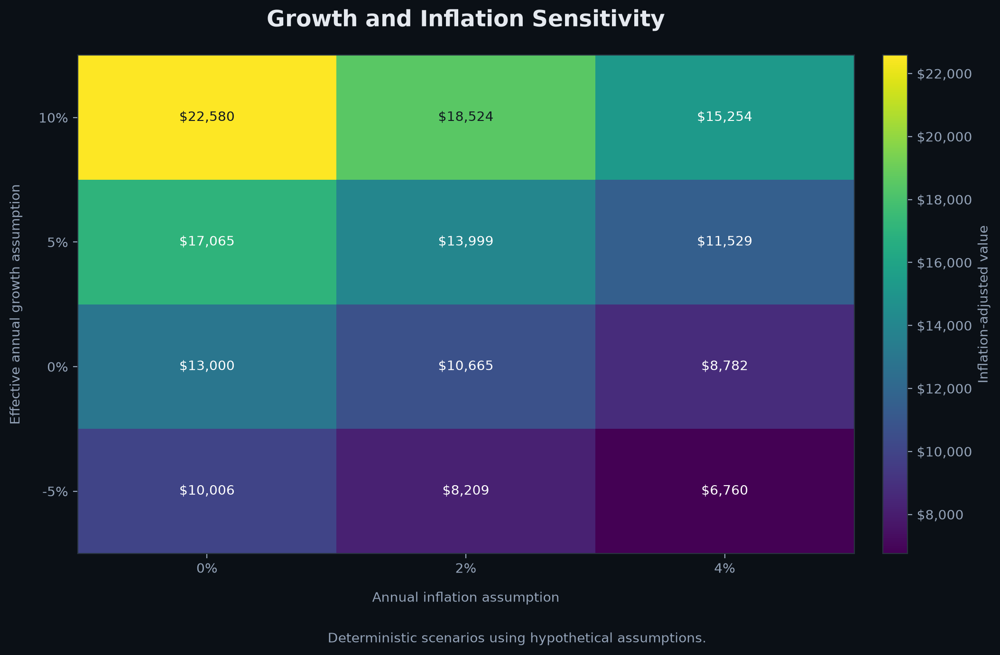
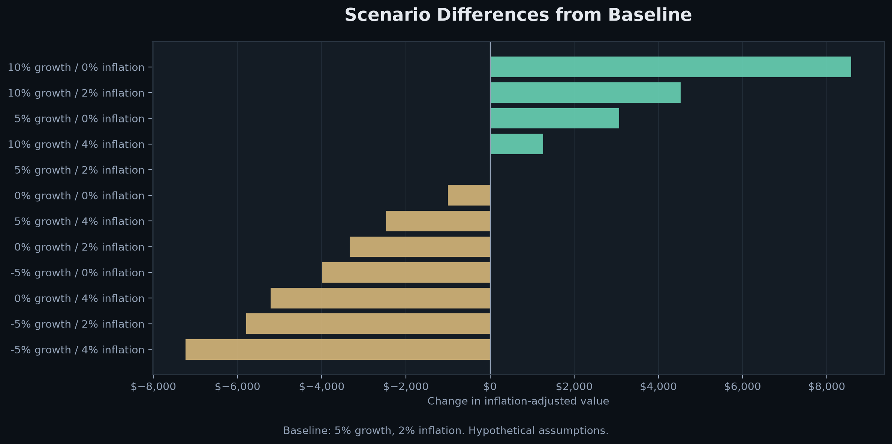
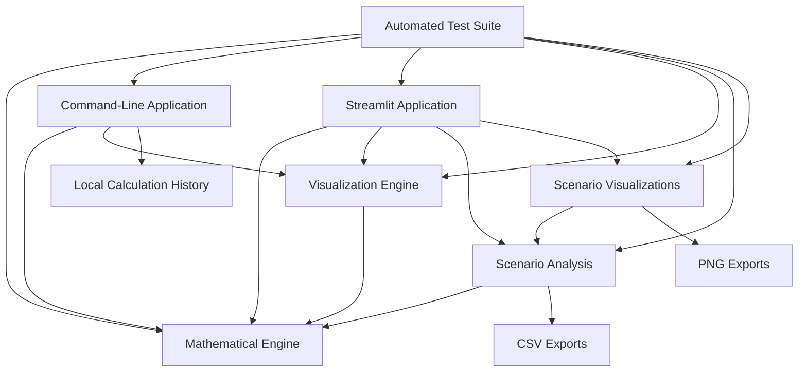

# Finance Calculator

[](https://docs.python.org/3.14/)
[](https://github.com/LakshSuri/finance-calculator/actions/workflows/ci.yml)
[](LICENSE)
[](tests/)

An interactive financial mathematics application for studying compound growth, periodic contributions, the time value of money, purchasing power, and sensitivity to hypothetical economic assumptions.

The project combines a validated Python mathematical engine, a command-line application, an interactive Streamlit website, and reproducible analytical visualizations.

**[Coding Journey — Portfolio Hub](https://github.com/LakshSuri/coding-journey) · [Launch Streamlit application](https://finance-research-lab.streamlit.app) · [Example Dataset](examples/example_scenarios.csv) · [Analytical Figures](examples/) · [Mathematical Framework](#mathematical-framework) · [Releases](https://github.com/LakshSuri/finance-calculator/releases) · [Continuous Integration](https://github.com/LakshSuri/finance-calculator/actions/workflows/ci.yml) · [Security Policy](SECURITY.md)**

## Overview

| Interactive Workspaces | Standalone Visualizations | Example Scenarios | Recorded Passing Tests |
|:---:|:---:|:---:|:---:|
| 5 | 8 | 12 | 225 |

| Component | Capability |
|---|---|
| Mathematical engine | Compound accumulation, annuities, discounting, and rate conversion |
| Command-line application | Ten menu options and local calculation history |
| Interactive website | Five analytical workspaces |
| Analytical visualizations | Eight Matplotlib visualization types |
| Scenario analysis | Configurable growth and inflation sensitivity |
| Data exports | CSV datasets and high-resolution PNG charts |
| Automated testing | 191 core tests and 34 web application tests |
| Continuous integration | Automated GitHub Actions quality checks |
| Security | CodeQL, dependency monitoring, and protected development history |

## Contents

- [Features](#features)
- [Interactive Application](#interactive-application)
- [Quick Start](#quick-start)
- [Mathematical Framework](#mathematical-framework)
- [Mathematical Usage Examples](#mathematical-usage-examples)
- [Scenario Analysis](#scenario-analysis)
- [Analytical Visualizations](#analytical-visualizations)
- [Software Architecture](#software-architecture)
- [Repository Structure](#repository-structure)
- [Technology Stack](#technology-stack)
- [Testing and Validation](#testing-and-validation)
- [Continuous Integration](#continuous-integration)
- [Security and Privacy](#security-and-privacy)
- [Model Limitations](#model-limitations)
- [Project Evolution](#project-evolution)
- [Development Roadmap](#development-roadmap)
- [Related Projects](#related-projects)
- [License](#license)

## Features

### Financial Mathematics

- Compound future value calculations
- Monthly contribution accumulation
- Inverse annuity and hypothetical goal calculations
- Combined principal and contribution projections
- Present value and discounting
- Inflation-adjusted purchasing power
- Effective and nominal interest-rate conversion
- Principal, contribution, and growth decomposition

### Numerical Methods

- Stable compound accumulation using `log1p` and `expm1`
- Explicit zero-rate handling
- Finite numerical input validation
- Negative-rate scenarios
- Overflow detection
- Whole-year duration validation
- Consistent end-of-month contribution timing

### Analytical Capabilities

- Deterministic growth and inflation scenario grids
- Comparisons against configurable baseline assumptions
- Minimum and maximum modeled values
- Purchasing power sensitivity
- Year-by-year numerical projections
- Structured CSV exports
- High-resolution PNG exports

## Interactive Application

The Streamlit application provides five analytical workspaces.

[Open the hosted Finance Calculator](https://finance-research-lab.streamlit.app). The local installation instructions below remain available.

| Workspace | Description |
|---|---|
| Overview | Project capabilities and illustrative projections |
| Growth Laboratory | Interactive principal, contribution, and purchasing power analysis |
| Financial Mathematics | Six mathematical calculation modes |
| Scenario Analytics | Sensitivity heatmaps, baseline comparisons, and numerical exports |
| Methodology | Equations, rate conventions, numerical methods, and limitations |

The website and command-line application share the same underlying mathematical engine.

Interactive charts are implemented using Plotly, while standalone analytical visualizations use Matplotlib.

## Quick Start

### Requirements

- Python 3.14
- Git
- pip

### Clone the Repository

```bash
git clone https://github.com/LakshSuri/finance-calculator.git
cd finance-calculator
```

### Create a Virtual Environment

macOS or Linux:

```bash
python3.14 -m venv .venv
source .venv/bin/activate
```

Windows PowerShell:

```powershell
py -3.14 -m venv .venv
.venv\Scripts\Activate.ps1
```

Windows compatibility has not been independently validated.

### Install Dependencies

```bash
python -m pip install -r requirements.txt
```

### Run the Command-Line Application

```bash
python main.py
```

### Run the Interactive Website

```bash
python -m streamlit run app.py
```

Open the local URL displayed in the terminal. The default local address is [http://localhost:8501](http://localhost:8501).

## Mathematical Framework

### 1. Compound Future Value

The accumulated value of an initial principal under a constant effective annual rate is:

$$
FV=P(1+r)^t
$$

Where:

- P is the initial principal.
- r is the effective annual rate in decimal form.
- t is the number of years.

Example:

A hypothetical principal of $1,000 compounded at 7% annually for ten years produces a modeled value of $1,967.15.

### 2. Monthly Contribution Accumulation

The future value of an ordinary annuity is:

$$
FV=C\frac{(1+i)^n-1}{i}
$$

Where:

- C is the end-of-month contribution.
- i is the monthly interest rate.
- n is the number of monthly contributions.

When the monthly rate equals zero:

$$
FV=Cn
$$

The original monthly contribution function uses a nominal annual rate divided by twelve.

### 3. Hypothetical Goal Calculation

Rearranging the ordinary annuity equation gives:

$$
C=\frac{FV\cdot i}{(1+i)^n-1}
$$

For a zero interest rate:

$$
C=\frac{FV}{n}
$$

This calculation determines the periodic contribution implied by a specified mathematical scenario.

### 4. Interest-Rate Conventions

For an effective annual rate:

$$
i=(1+r)^{1/12}-1
$$

For a nominal annual rate convertible monthly:

$$
i=\frac{j}{12}
$$

The equivalent nominal annual rate is:

$$
j=12i
$$

The original monthly accumulation and goal functions retain their nominal annual rate convention for backward compatibility.

Combined projections use effective annual rates.

Public financial calculation functions accept percentage inputs. Internal calculations convert percentages to decimal rates.

### 5. Combined Growth Projection

The combined value of an initial principal and periodic contributions is:

$$
FV=P(1+r)^t+C\frac{(1+i)^{12t}-1}{i}
$$

Where the effective monthly rate is derived from the effective annual rate.

At a zero growth rate:

$$
FV=P+12tC
$$

### 6. Present Value

The present value of a future amount is:

$$
PV=\frac{FV}{(1+r)^t}
$$

### 7. Inflation Adjustment

Nominal future values are adjusted for purchasing power using:

$$
V_{\mathrm{real}}=
\frac{V_{\mathrm{nominal}}}{(1+\pi)^t}
$$

Where the inflation rate is represented by the decimal value of pi.

### 8. Growth Decomposition

Total contributed principal is:

$$
P_{\mathrm{total}}=P+12tC
$$

Nominal growth or loss is:

$$
G=FV-P_{\mathrm{total}}
$$

A negative result represents a modeled loss relative to contributed principal.

### 9. Numerical Stability

Directly evaluating expressions near zero interest rates can introduce floating-point cancellation errors.

The mathematical engine uses the equivalent expression:

$$
(1+i)^n-1=
\operatorname{expm1}
\left(n\operatorname{log1p}(i)\right)
$$

This improves numerical accuracy for small interest rates.

Zero-rate calculations are handled explicitly.

## Mathematical Usage Examples

```python
from calculator import (
    future_value,
    future_value_monthly,
    monthly_investment_goal,
    present_value,
    projection_breakdown
)

print(round(future_value(1000, 7, 10), 2))

print(round(future_value_monthly(100, 7, 10), 2))

print(round(monthly_investment_goal(50000, 7, 10), 2))

print(round(present_value(1210, 10, 2), 2))

projection = projection_breakdown(
    starting_amount=1000,
    monthly_amount=100,
    annual_rate=5,
    years=10,
    inflation_rate=2
)

print(projection)
```

The first four calculations produce:

| Calculation | Result |
|---|---:|
| Compound future value | $1,967.15 |
| Monthly contribution accumulation | $17,308.48 |
| Hypothetical periodic contribution | $288.88 |
| Present value | $1,000.00 |

All examples use synthetic mathematical assumptions.

## Scenario Analysis

The scenario analysis engine evaluates combinations of effective annual growth and inflation assumptions.

The demonstration dataset uses:

| Parameter | Assumption |
|---|---|
| Initial principal | $1,000 |
| Monthly contribution | $100 |
| Duration | 10 years |
| Growth assumptions | -5%, 0%, 5%, 10% |
| Inflation assumptions | 0%, 2%, 4% |
| Baseline growth | 5% |
| Baseline inflation | 2% |
| Total scenarios | 12 |

Each scenario is compared with a common baseline:

$$
\Delta V=
V_{\mathrm{scenario}}-V_{\mathrm{baseline}}
$$

The analytical engine records nominal future value, contributed principal, nominal growth, inflation-adjusted value, and the difference from the baseline.

### Run Scenario Analysis

```bash
python scenario_analysis.py
```

### Export Scenario Results

```bash
mkdir -p exports
python scenario_analysis.py --output exports/scenarios.csv
```

The export function prevents accidental overwriting of existing files.

A reproducible example dataset is available in:

[Example Scenario Dataset](examples/example_scenarios.csv)

## Analytical Visualizations

The standalone visualization modules provide eight chart types.

| Visualization | Purpose |
|---|---|
| Compound Growth | Year-by-year accumulation |
| Annual Balance | Comparative annual balances |
| Growth Rate Comparison | Sensitivity to alternative growth assumptions |
| Combined Projection | Nominal value, real value, and total principal |
| Contribution Breakdown | Principal, contributions, and growth |
| Inflation Comparison | Purchasing power sensitivity |
| Sensitivity Heatmap | Joint growth and inflation analysis |
| Baseline Comparison | Differences from a common baseline |

### Growth and Inflation Sensitivity



This heatmap illustrates modeled purchasing power under twelve hypothetical combinations of growth and inflation assumptions.

### Baseline Comparison



This visualization measures the difference between each scenario and the specified baseline.

### Generate Analytical Charts

```bash
python scenario_visualization.py --chart heatmap
python scenario_visualization.py --chart baseline
```

### Export Analytical Charts

```bash
mkdir -p exports

python scenario_visualization.py \
    --chart heatmap \
    --output exports/sensitivity_heatmap.png

python scenario_visualization.py \
    --chart baseline \
    --output exports/baseline_comparison.png
```

The scenario results represent a deterministic grid rather than a probability distribution.

## Software Architecture



The architecture separates mathematical calculations, presentation, analytical workflows, data exports, and automated testing.

## Repository Structure

```text
finance-calculator/
├── .github/
│   ├── workflows/
│   │   └── ci.yml
│   └── dependabot.yml
├── .streamlit/
│   └── config.toml
├── examples/
│   ├── baseline_comparison.png
│   ├── example_scenarios.csv
│   └── sensitivity_heatmap.png
├── tests/
│   ├── test_app.py
│   ├── test_calculator.py
│   ├── test_interface.py
│   ├── test_scenario_analysis.py
│   ├── test_scenario_visualization.py
│   └── test_visualization.py
├── .gitattributes
├── .gitignore
├── app.py
├── calculator.py
├── history.py
├── main.py
├── scenario_analysis.py
├── scenario_visualization.py
├── visualization.py
├── requirements.txt
├── LICENSE
├── SECURITY.md
└── README.md
```

## Technology Stack

| Technology | Purpose |
|---|---|
| Python | Mathematical and application development |
| Streamlit | Interactive web interface |
| Plotly | Interactive analytical visualizations |
| Matplotlib | Standalone charts and PNG exports |
| pandas | Structured analytical data |
| NumPy | Scientific computing dependency |
| pytest | Automated testing |
| GitHub Actions | Continuous integration |
| CodeQL | Static security analysis |
| Dependabot | Dependency maintenance |

## Testing and Validation

The recorded test suite contains 225 passing automated test cases.

| Test Category | Coverage |
|---|---|
| Mathematical engine | Numerical accuracy and boundary conditions |
| Mathematical consistency | Inverse relationships and independent iterative validation |
| Command-line application | Navigation, input recovery, and calculation history |
| Financial visualizations | Data accuracy and chart rendering |
| Scenario analysis | Scenario construction, baseline comparison, and CSV exports |
| Scenario visualizations | Matrix construction, rendering, and PNG exports |
| Web application | Page navigation, interactive inputs, and mathematical outputs |

### Recorded Validation Results

| Test Suite | Passing Tests |
|---|---:|
| Core mathematical and analytical tests | 191 |
| Streamlit application tests | 34 |
| Total | 225 |

### Execute All Tests

```bash
python -m pytest -q
```

For headless visualization testing on macOS or Linux:

```bash
MPLBACKEND=Agg python -m pytest -q
```

### Execute Core Tests

```bash
python -m pytest -q --ignore=tests/test_app.py
```

### Execute Website Tests

```bash
python -m pytest tests/test_app.py -q
```

### Verify Dependency Compatibility

```bash
python -m pip check
```

## Continuous Integration

GitHub Actions performs automated quality checks when changes are pushed to the main branch or when a pull request targets the main branch.

The workflow includes:

- Python environment configuration
- Dependency installation
- Dependency compatibility verification
- Python compilation
- Core mathematical and analytical tests
- Interactive website tests
- CSV generation
- PNG chart generation

[View Continuous Integration Results](https://github.com/LakshSuri/finance-calculator/actions)

## Security and Privacy

The repository incorporates:

- Numerical input validation
- Version-pinned dependencies
- Automated dependency update proposals
- Restricted workflow permissions
- CodeQL static analysis
- Branch deletion and force-push protection
- Exclusion of credentials and local calculation records

The command-line application stores calculation history locally.

Calculation history is excluded from version control.

The Streamlit application does not intentionally persist visitor inputs in a calculation history file or application database.

Users should not enter confidential financial information.

For vulnerability reporting, see the [Security Policy](SECURITY.md).

## Model Limitations

The calculations rely on simplified mathematical assumptions.

- Growth rates remain constant throughout each scenario.
- Inflation rates remain constant throughout each scenario.
- Contributions occur at the end of each month.
- Taxes, transaction costs, and management fees are excluded.
- Actual market volatility is not modeled.
- Scenario outcomes are not assigned probabilities.
- Minimum and maximum scenario values are not statistical confidence intervals.
- Modeled results do not guarantee actual future outcomes.

This project is intended for educational mathematical analysis rather than personalized investment recommendations.

## Project Evolution

The project has developed from a basic compound interest calculator into a modular financial mathematics laboratory.

Major development milestones include:

1. Initial compound growth calculations.
2. Monthly contribution and goal calculations.
3. Local calculation history.
4. Financial visualization tools.
5. Automated mathematical testing.
6. Numerically stable mathematical methods.
7. Combined growth and purchasing power analysis.
8. Deterministic scenario analytics.
9. Interactive web application.
10. Automated quality checks and security infrastructure.

The repository preserves its development history through version-controlled changes.

## Development Roadmap

Potential future enhancements include:

- Variable annual growth assumptions
- Variable contribution schedules
- Additional cash-flow timing conventions
- Expanded fee and expense models
- More extensive browser-level testing
- Accessibility improvements
- Additional numerical stress testing

These enhancements are planned rather than currently implemented.

## Related Projects

- [Coding Journey — Portfolio Hub](https://github.com/LakshSuri/coding-journey)
- [Derivatives Pricing Laboratory](https://github.com/LakshSuri/derivatives-pricing-lab)
- [Interactive Derivatives Pricing Application](https://derivatives-research-lab.streamlit.app)
- [Monte Carlo Simulator](https://github.com/LakshSuri/monte-carlo-simulator)

## License

This project is distributed under the MIT License.

See [LICENSE](LICENSE) for the complete license terms.

---

Finance Calculator | Financial Mathematics and Deterministic Scenario Analysis
